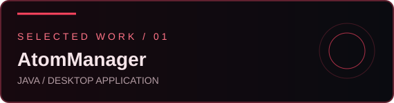
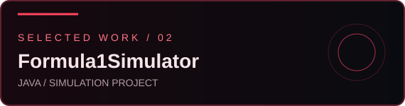
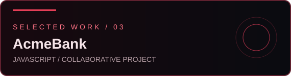

 

 

 

I am **Juan Pablo Conde Zapata**, a **Software Development Technician** with hands-on full-stack project experience and a strong focus on **backend development, software architecture, and building reliable, maintainable applications**.

I work with **Java, Spring Boot, JavaScript, TypeScript, Angular, Node.js, Python, SQL/NoSQL, and Git**. I value analytical thinking, clear communication, problem solving, and continuous improvement.

> Building software with intention: thoughtful structure, practical solutions, and room to grow.

**LANGUAGES**

  

**FRAMEWORKS & RUNTIME**

  

**DATABASES & VERSION CONTROL**

These icons represent technologies listed in my CV, not claimed proficiency levels.

<table>
<tr>
<td width="50%" valign="top">

**AtomManager** · Java

A Java project from my public repositories. Explore the source for the implementation and structure.

[Explore repository](https://github.com/CondezJuan8/AtomManager)
</td>
<td width="50%" valign="top">

**Formula1Simulator** · Java

A public Java simulation project included in my development portfolio.

[Explore repository](https://github.com/CondezJuan8/Formula1Simulator)
</td>
</tr>
<tr>
<td width="50%" valign="top">

**AcmeBank** · JavaScript

A collaborative JavaScript project, publicly available on my profile.

[Explore repository](https://github.com/CondezJuan8/ProyectoAcmeBank_JS_CondeJ-CamayoIsaac)
</td>
<td width="50%" valign="top">

**FutbolistasChatbot** · Python

A public Python chatbot project representing practical development work.

[Explore repository](https://github.com/CondezJuan8/FutbolistasChatbot)
</td>
</tr>
</table>

### Collaborative work

**Campuslands Hub** · Angular / TypeScript  
A collaborative event-management web application. I contributed to interfaces and features using Angular and TypeScript, applying version control and team development practices.

**XEON — AI Quotation Agent** · Collaboration referenced  
A project collaboration involving an AI-assisted quotation agent. Detailed contributions and a public repository link are not publicly verified.

**ToolRental Platform** · Collaboration referenced  
A collaborative software project. Detailed contributions and a public repository link are not publicly verified.

**How I approach software**

- **Structure first:** designing clear, maintainable components and workflows.
- **Problem solving:** breaking down complex requirements into practical solutions.
- **Collaboration:** communicating clearly, using version control, and working effectively with teams.
- **Quality mindset:** prioritizing readability, reliability, and continuous refinement.

**Languages:** Spanish (native) · English (B2.1)

Live third-party widgets may occasionally be unavailable. Language charts reflect public repository metadata, not a proficiency ranking.

**Interested in exchanging ideas, collaborating, or discussing software development?**

[LinkedIn](https://www.linkedin.com/in/condezp8) · [GitHub](https://github.com/CondezJuan8) · [Email](mailto:condez.juanp@gmail.com)

 

