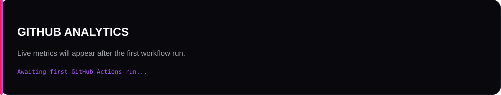
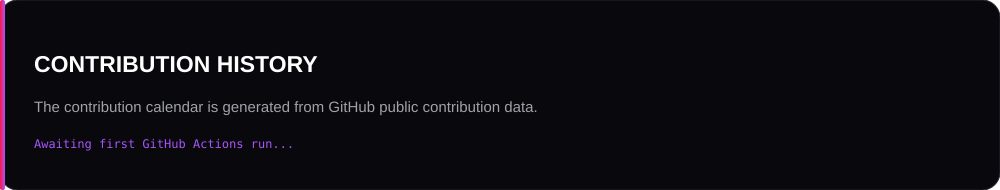

<div align="center">



<br>

<a href="../CV%20-%20ATS%20.pdf">
  
</a>
&nbsp;
<a href="https://github.com/CondezJuan8">
  
</a>
&nbsp;
<a href="https://www.linkedin.com/in/condezp8">
  
</a>

<br><br>

**SOFTWARE DEVELOPMENT TECHNICIAN** &nbsp;·&nbsp; **GLOBANT** &nbsp;·&nbsp; **COLOMBIA**

*Building software. Engineering solutions. Creating impact.*

</div>

---

## / PROFILE

I'm a Software Development Technician passionate about backend engineering, software architecture, databases, and building scalable applications. I enjoy solving complex problems, exploring new technologies, and transforming ideas into functional software.

My main interests are designing maintainable systems, understanding how software works beneath the interface, and creating reliable solutions through thoughtful engineering.

<pre>
  CONDEZ / SOFTWARE ENGINEERING
  ├── Focus       Backend development · Software architecture
  ├── Ecosystem   Java · Spring Boot · TypeScript · Python
  ├── Data        PostgreSQL · MongoDB · SQL · NoSQL
  ├── Frontend    Angular · React
  └── Based in    Colombia
</pre>

---

## / TECHNOLOGY STACK

Technologies and tools used across my learning and development projects.

<div align="center">

### BACKEND ENGINEERING


### FRONTEND DEVELOPMENT


### DATABASES & DATA


### ENGINEERING TOOLKIT


</div>

<sub>SQL and NoSQL are database paradigms rather than individual products; PostgreSQL, MySQL and MongoDB are shown as representative technologies. This section does not claim proficiency levels.</sub>

---

## / GITHUB ANALYTICS

A first-party analytics dashboard generated from GitHub's GraphQL and REST APIs by GitHub Actions. The SVG files are stored in this repository and refreshed automatically every day.

<div align="center">
  
  <br><br>
  
  <br><br>
  
</div>

<sub>Metrics include public repositories, stars, forks, followers, public contribution history, streaks, language composition and recent public events. Contribution totals cover the previous 12 months. Language proportions are calculated from source-code byte sizes across owned, non-forked public repositories. Private activity is not included. Data refreshes daily after the scheduled workflow runs.</sub>

<sub>Profile view counts are intentionally omitted: GitHub does not expose profile visitor totals through the public APIs used by this workflow, and this first-party setup does not rely on a third-party visitor counter.</sub>

---

## / SELECTED WORK

A selection of public repositories, ordered by technical scope and the engineering concepts they demonstrate. Descriptions and technology labels are based on the repositories' public documentation and visible source structure.

### 01 — Formula1Simulator
**Desktop simulation · Java 17 · JavaFX · MySQL**

A desktop application that simulates a Formula 1 qualifying session. It models drivers, teams, cars, circuits, vehicle setup, weather and track evolution, then calculates session results with telemetry and dynamic events.

- Hexagonal architecture with domain, application, and adapter layers.
- JavaFX interface with 24 FXML views.
- MySQL persistence with an in-memory fallback.
- Public README documents 230 passing tests.

<a href="https://github.com/CondezJuan8/Formula1Simulator"></a>


### 02 — AtomManager
**Desktop task management · Java 17 · JavaFX**

A desktop task manager inspired by Jira and Trello. It supports users, task assignment, priorities and status tracking, using object-oriented design and SOLID principles.

- JavaFX graphical interface.
- `Map` / `HashMap` for in-memory data management.
- `PriorityQueue` for priority-based ordering.
- The repository README reports 20 passing tests for the implemented epics.

<a href="https://github.com/CondezJuan8/AtomManager"></a>


### 03 — Tribuna Global IA
**AI-assisted opinion analysis · Python · Streamlit · LangChain**

A Streamlit application for collecting opinions about football players, classifying them with Gemini through LangChain, and consulting stored opinions after restarting the application.

- Structured AI output and validated data handling.
- Persistent opinion storage and filtering.
- Docker configuration and automated tests documented in the repository.

<a href="https://github.com/CondezJuan8/FutbolistasChatbot"></a>


### 04 — AcmeBank
**Collaborative web application · HTML · CSS · JavaScript**

A browser-based digital banking application for account self-management. The documented scope includes authentication, registration, password recovery, account operations, transaction summaries and PDF certificate generation. Data is stored in browser `localStorage`; the project does not claim a backend service.

**Documented team:** Juan Pablo Conde and Manuel Isaac Díaz.

<a href="https://github.com/CondezJuan8/ProyectoAcmeBank_JS_CondeJ-CamayoIsaac"></a>


### 05 — DeliveryBot / Proyecto_N8NConde
**Workflow automation · n8n · Telegram Bot API · Google Sheets**

An automated delivery-order workflow connecting Telegram and Google Sheets. Customers can browse categories, build a cart, confirm or cancel orders, and check order history and status. An administrator can review reports and update order states.

<a href="https://github.com/CondezJuan8/Proyecto_N8NConde"></a>


---

## / COLLABORATIVE ENGINEERING

<div align="center">

<a href="https://github.com/CondezJuan8">
  
</a>
&nbsp;
<strong>×</strong>
&nbsp;
<a href="https://github.com/dvanielx03">
  
</a>

### CONDEZ × DVANIELX03
**COLLABORATIVE ENGINEERING**

*Two developers. Shared ideas. Engineered solutions.*

</div>

I value collaborative development, clear communication, version control and shared problem-solving. This section links both developer identities so visitors can explore their public work.

**Verification note:** I could not establish a publicly verifiable shared repository, pull request, or commit involving both `CondezJuan8` and `dvanielx03` from the public evidence reviewed for this README. I am therefore not presenting a repository as a joint project or attributing commits to either developer without evidence.

<div align="center">

<a href="https://github.com/CondezJuan8">Condez — GitHub profile</a>
&nbsp; · &nbsp;
<a href="https://github.com/dvanielx03">dvanielx03 — GitHub profile</a>

</div>

### Team development

- Collaborative project experience is documented in the AcmeBank repository, which credits Juan Pablo Conde and Manuel Isaac Díaz.
- Git-based project work and repository documentation are visible across the selected projects.
- External open-source contributions and code-review activity are not claimed here unless they can be verified publicly.

> Great software is rarely built alone. Collaboration turns ideas into better engineering.

**Have an interesting project? Let's build something meaningful together.**

---

## / CONTRIBUTION ACTIVITY

The contribution calendar above is generated directly from GitHub's contribution data and stored as `stats/contributions.svg`. It is refreshed automatically by GitHub Actions.

---

## / TERMINAL

```bash
$ whoami
Condez

$ role
Software Development Technician

$ organization
Globant

$ interests
Backend Engineering
Software Architecture
Database Systems
Full-Stack Development

$ mission
Build meaningful software and solve real-world problems.
```

---

## / CONNECT

<div align="center">

<a href="https://github.com/CondezJuan8">
  
</a>
<a href="https://www.linkedin.com/in/condezp8">
  
</a>

<br><br>

**Open to meaningful conversations, engineering challenges and collaborative projects.**

</div>

---

<div align="center">
  <sub>CONDEZ · SOFTWARE DEVELOPMENT · COLOMBIA</sub>
  <br>
  <sub>Designed to build. Engineered to evolve.</sub>
</div>
